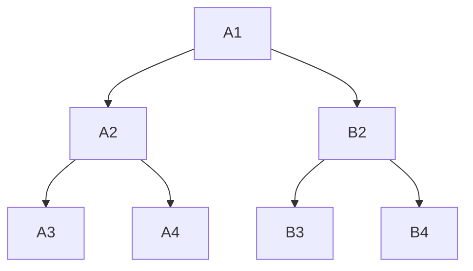

# Peer Messaging for Hermes

Пассивная переписка локальных CLI, TUI и Desktop-сессий и их сабагентов. Плагин передаёт сообщения, не запускает задачи и не пробуждает получателя. Делегирование, steering и итоговые отчёты остаются у `delegate_task`.

## Установка

```sh
hermes plugins install Xipong/hermes-peer-messaging --no-enable
hermes plugins enable peer-messaging
```

Требуется Hermes с `persistence_assembly`, нативным хранилищем сабагентов и хуками запросов/результатов инструментов. После обновления открой новые сессии: Hermes закрепляет схемы инструментов в беседе. Плагин использует существующий каталог `runtime/peer_messages_v2`; опубликованные письма сохраняются, другие каталоги не затрагиваются.

## Границы общения

Агент может писать непосредственному родителю, прямым детям и братьям с общим непосредственным родителем. Независимые корни одного профиля также могут писать друг другу.



| Агент | Доступные собеседники |
|---|---|
| A1 | A2, B2, другие независимые корни |
| A2 | A1, B2, A3, A4 |
| B2 | A1, A2, B3, B4 |
| A3 / A4 | A2 и друг друга |
| B3 / B4 | B2 и друг друга |

Если A3 обнаружит общую проблему рендеринга, он сообщает A2. Координаторы A2/B2 согласуют решение и информируют своих исполнителей; при необходимости вопрос поднимается A1. Автоматической ретрансляции нет.

Каталог и отправка используют одну проверку родства по устойчивому ID родителя. Известный адрес, общий проект или короткий ID сабагента не расширяют права. Compaction сохраняет логическую беседу и родство между батчами; branch/reset не наследуют чужой ящик. Другие профили, Gateway и BotMode не поддерживаются.

## Инструменты

| Инструмент | Когда использовать |
|---|---|
| `peer_sessions(scope="all", same_project=true, active_within_minutes=60)` | Найти разрешённого адресата. |
| `peer_send(target_session_id, message, in_reply_to?)` | Отправить сообщение. `parent` выбирает непосредственного родителя. |
| `peer_receive(action="read", limit=5)` | Прочитать почту явно, если она нужна до следующего результата инструмента. `action="ack", message_ids=[…]` — подтвердить полностью прочитанные повторные письма. |

Блокер, передачу общего ресурса или смену границ работы отправляй сразу, если иначе коллега будет ждать или продолжит по устаревшим условиям. Обычные апдейты одному адресату объединяй в одно письмо на контрольной точке. Если уже знаешь, что написать, добавь `peer_send` в один батч с независимым рабочим инструментом, а не выделяй под письмо отдельный цикл модели. Если текст зависит от результата инструмента, сначала получи результат. Финальные отчёты сабагентов и так возвращает `delegate_task`.

`thread_id` — устойчивый адрес; `session_id` — текущий физический сегмент. Отправка принимает оба. `relation` описывает доступного участника относительно вызывающего: `parent`, `child`, `sibling`, `peer`, `self`. Недоступные адреса предков скрываются.

`peer_send` возвращает `queued`, то есть письмо записано. `recipient_state` сообщает `owner_present`, подтверждённое состояние сабагента в нативном хранилище (`subagent_state`) и `last_activity_at`. `null` означает неизвестное состояние. Наличие владельца или запись running не доказывают, что модель сейчас выполняет ход.

### Каталог

| Scope | Корневой агент | Сабагент |
|---|---|---|
| `roots` | Другие независимые корни | Родитель, если он корень |
| `team` | Прямые дети | Родитель, прямые дети, братья |
| `all` | Дети и другие корни | Как team |

По умолчанию чужие корни ищутся в том же нативном Project Hermes; для бесед без Project используется `git_repo_root`, затем `cwd`. `same_project=false` расширяет только поиск корней, а не права отправки. Окно активности составляет 1–1440 минут; непосредственный родитель и сессии с живым владельцем не отбрасываются по возрасту.

Семья ищется по нативным маркерам делегирования в проверенных сегментах родителя и вызывающего. Лимит 100 кандидатов относится только к независимым корням; неполнота обозначается `scan_limited_sources` и `scan_may_be_truncated`.

### Автоматические обновления

На подходящих результатах инструментов приходит `peer_update`:

- `neighbors` — до восьми новых корней своего проекта; `has_more` предлагает открыть каталог.
- `parent` — адрес непосредственного родителя сабагента.
- `mail_pending` — запасная отметка о почте.

Известные адреса не повторяются в пределах жизни процесса и ограниченного кеша. Корневой поиск использует интервал пять секунд и общий кеш на профиль. События чужих сабагентов не рассылаются. В начале хода возможна короткая подсказка о почте без её текста.

## Доставка

Один постоянный ящик на `thread_id`. Лимиты: 50 ожидающих писем на участника, 8000 символов UTF-8 на письмо, до пяти писем и обычно 12000 сериализованных символов на порцию. Допустимое одиночное письмо передаётся целиком, даже если JSON-экранирование увеличивает его сверх обычного лимита.

Почта добавляется как `peer_data` к одному подходящему результату инструментов в батче; для обычного текста используется помеченный блок. JSON-массивы и скаляры не меняются. Повторное явное чтение в том же батче не дублирует уже подготовленные тела.

Автоматический ACK требует полного блока в сохранённом транскрипте и исходящем запросе, затем успешного ответа провайдера. Поддерживаются Chat Completions, Responses/Codex и Anthropic. При обрезке, ошибке сохранения/API, отмене или занятой блокировке письмо остаётся в очереди. MoA и `llm_execution` middleware отключают автоматический ACK, если полный путь нельзя подтвердить.

Доставка допускает повтор одного ID. ACK подтверждает попадание в контекст, а не выполнение поручения. Письма — данные коллег, не инструкции пользователя. Нет фонового опроса, дополнительных запросов модели или автоматического пробуждения.

### Архив

Явный поиск корневого агента может проверить до 16 ящиков за проход, не чаще раза в 10 минут на профиль в процессе. Ящик архивируется только если текущий сегмент закрыт не менее 24 часов и не наблюдается владелец. Для сабагента дополнительно нужна проверенная терминальная запись не моложе 24 часов без pin/owed. Resumable, running, claimed, неизвестное состояние и незавершённая цепочка compaction пропускаются.

Письма перемещаются под блокировкой в `runtime/peer_messages_v2/.archive/<thread_id>/`. При возобновлении архив и новая почта читаются в общей очереди FIFO, с общим лимитом и ACK. Неподтверждённые действительные письма автоматически не удаляются.

## Код и проверки

| Модуль | Назначение |
|---|---|
| `service.py` | Инструменты и хуки уведомлений |
| `teams.py` | Идентичность, маршрутизация и родство |
| `discovery.py`, `project_identity.py` | Каталог и проекты |
| `mailbox.py` | Постоянная очередь, архив, ACK |
| `delivery.py` | Перенос писем в результаты и проверка доставки |
| `lifecycle.py` | Состояние получателя и уборка |

```sh
hermes plugins doctor --ci .
# Из checkout Hermes:
scripts/run_tests.sh /path/to/hermes-peer-messaging/tests/
```

Тесты используют временные профили без реальных запросов моделей. Принцип пассивной доставки заимствован у Codex; почтовый ящик основан на [Hermes #106423](https://github.com/NousResearch/hermes-agent/pull/106423) и [#123218](https://github.com/NousResearch/hermes-agent/pull/123218). См. LICENSE.
