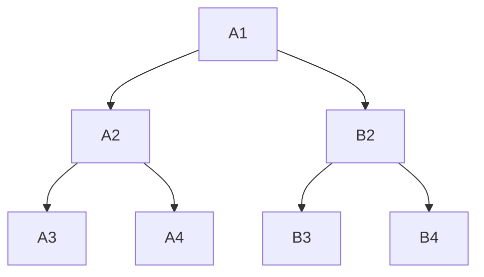

# Peer Messaging for Hermes

Пассивная локальная переписка между CLI, TUI и Desktop-беседами Hermes и их сабагентами в одном профиле. Общение следует структуре делегирования: **непосредственный родитель, прямые дети, братья с общим непосредственным родителем**. Независимые главные агенты могут писать друг другу и координировать свои ветки.

## Установка и обновление

```sh
hermes plugins install Xipong/hermes-peer-messaging --no-enable
hermes plugins enable peer-messaging
```

Открой новые сессии после включения или обновления, чтобы получить актуальные закреплённые описания инструментов. Требуется Hermes с API `persistence_assembly` и хуками запросов/результатов инструментов.

**0.11:** три инструмента, адресное обнаружение семьи, информационный снимок получателя и безопасное архивирование закрытых ящиков. Границы 0.10 сохраняются; `link_thread` и список контактов удалены, поскольку они не давали разрешений на отправку. Старые `.threads.json` и `.threads.lock` не читаются и не удаляются автоматически.

При обновлении с 0.9/0.10 используется прежний `<Hermes home>/runtime/peer_messages_v2`: ранее опубликованные письма сохраняются. Новые отправки проверяются по действующим границам, старое письмо можно получить даже при изменившейся политике.

Для версий до 0.9 сохраняется прежний разрыв: каталог `peer_messages` не читается, не переносится и не удаляется автоматически. Старые схемы инструментов не восстанавливаются.

## Кто с кем общается

В этой схеме стрелки обозначают создание сабагентов:



| Участник | Разрешённые собеседники в этой схеме |
|---|---|
| A1 | A2, B2; также другие независимые корневые беседы |
| A2 | A1, B2, A3, A4 |
| B2 | A1, A2, B3, B4 |
| A3 | A2, A4 |
| A4 | A2, A3 |
| B3 | B2, B4 |
| B4 | B2, B3 |

Если A3 создаст собственных детей, они тоже станут его разрешёнными собеседниками. A3 не видит адреса A1, B2, B3 и B4 в каталоге и не может написать им напрямую, даже зная ID. Обратные отправки через те же границы тоже запрещены. Совпадение проекта, корневой команды или короткого `_subagent_id` не дают дополнительных разрешений.

Братья определяются по **проверенному устойчивому ID непосредственного родителя**, а не по одному батчу `delegate_task` или одинаковому уровню вложенности. Если родитель сжал контекст между двумя делегированиями, его дети остаются братьями. Compaction сохраняет логическую беседу; branch/reset и повторно использованный короткий ID не наследуют чужую семью или ящик. Gateway, BotMode и другие профили не допускаются к маршрутизации.

## Как передавать общую проблему

Например, A3 обнаружил проблему рендеринга, затрагивающую обе ветки:

1. A3 отправляет A2 короткое описание через `peer_send(target_session_id="parent", message=…)`: что сломано, как воспроизвести и какая помощь нужна.
2. A2 выясняет масштаб. Для согласования с соседней веткой он может написать B2; для решения на уровне всей задачи — поднять вопрос A1.
3. Координаторы согласуют решение и передают его своим прямым детям, которых оно касается. B2 информирует B3/B4, A2 — A3/A4.
4. Исполнители продолжают свои задачи и возвращают результат своему родителю.

Эти сообщения отправляют сами агенты. Автоматической ретрансляции, массовой рассылки и пробуждения нет. Описания инструментов прямо предлагают поднимать общие проблемы родителю. Доставка письма не гарантирует, что координатор уже работает или выполнил поручение; запуск задач, ожидание их завершения и steering остаются у нативного `delegate_task`.

## Три инструмента

| Инструмент | Назначение |
|---|---|
| `peer_sessions(scope="roots"\|"team"\|"all", same_project=true)` | Найти разрешённые адреса. По умолчанию `scope="all"`, окно активности 60 минут. |
| `peer_send(target_session_id, message, in_reply_to?)` | Поставить письмо разрешённому адресату в очередь. `target_session_id="parent"` выбирает непосредственного родителя сабагента. |
| `peer_receive(limit=5)` | Немедленно прочитать почту, если обычного результата инструмента сейчас не будет. `action="ack", message_ids=[…]` — для уже полностью прочитанных повторов. |

`link_thread`, `create_thread`, `read_thread`, `wait_threads`, `list_threads` и старые параметры ожидания отсутствуют. Плагин не создаёт соседнюю сессию, не запускает её и не читает чужой транскрипт. `peer_send` возвращает `status="queued"`, а не подтверждение принятой в работу задачи. `recipient_state` содержит `owner_present` (найденный владелец процесса, `null` при недоступности снимка), `subagent_state` (проверенная запись native ledger или `null`) и `last_activity_at`. Это не доказательство работающего LLM-хода, свободного координатора или готовности отвечать. Не жди и не опрашивай почту в цикле. Не дублируй финальный отчёт `delegate_task`.

### Область поиска и адреса

Все `scope` применяются **внутри разрешённого круга общения**:

| Scope | Для корневого агента | Для вложенного агента |
|---|---|---|
| `roots` | Другие независимые корни | Только непосредственный родитель, если он сам корень; иначе пусто |
| `team` | Прямые дети | Непосредственный родитель, прямые дети и братья |
| `all` | Прямые дети и другие независимые корни | Тот же разрешённый круг, что у `team` |

По умолчанию чужие корни ищутся в том же проекте: сначала нативный Project Hermes по зарегистрированным папкам в `projects.db`, затем `git_repo_root` или `cwd`. Свои разрешённые родственники доступны независимо от папки. `same_project=false` расширяет поиск по профилю, но не разрешения. Окно активности фильтрует кандидатов; непосредственный родитель добавляется отдельно, даже при старом штампе активности, если его беседа ещё доступна.

Поиск независимых корней проверяет до 100 локальных записей; `scan_limited_sources` и `scan_may_be_truncated` сообщают о неполноте этой выборки. Прямые дети и братья ищутся через нативный `subagent_session_ids(parent_segment, "_delegate_from")` по подтверждённым сегментам непосредственного родителя. Чужие сабагенты не расходуют лимит семейного поиска. Кандидаты проходят прежнюю проверку происхождения и разрешений; маркер сам по себе не даёт доступа. Живая аренда процесса может компенсировать старый штамп активности. `owner_present` сообщает только о найденном владельце процесса и не доказывает работающий ход.

`thread_id` — устойчивый адрес логической беседы, `session_id` — текущий физический сегмент. Оба принимаются при отправке. `parent_thread_id` используется для сравнения родителей; `parent_session_id` может указывать на старый сегмент, в котором произошло делегирование. Поле `relation` показывает отношение к вызывающему: `self`, `parent`, `child`, `sibling` или `peer` для другого корня.

Метаданные тоже ограничены: вложенному агенту не выдаётся адрес недоступного корня, а в описании его родителя скрывается адрес следующего предка. В результате отправки возвращаются `from_thread_id` и `target_thread_id` участников конкретного обмена.

Независимые корни одного профиля могут писать друг другу без предварительной связи, в том числе по известному адресу вне проекта или окна активности. Для явного поиска по профилю используют `peer_sessions(scope="roots", same_project=false)`. Постоянный список контактов не поддерживается.

## Обнаружение без спама

Главные агенты получают компактный блок в подходящем результате обычного инструмента:

```json
{"peer_update":{"authority":"peer_data","neighbors":["stable-root-id"]}}
```

Автоматический поиск просматривает только независимые локальные беседы текущего проекта. Появление, завершение и сжатие чужих сабагентов не создают уведомлений. Новые корневые адреса показываются один раз за логическую беседу в пределах жизни процесса и ограниченного кеша; смена физического ID при compaction и новый ход не сбрасывают осведомлённость. До восьми новых корней за обновление, при большем числе — `has_more=true`.

Сабагент автоматически получает **только адрес непосредственного родителя**:

```json
{"peer_update":{"authority":"peer_data","parent":"stable-parent-id"}}
```

Своих детей агент знает из `delegate_task`; братьев при необходимости находит через `peer_sessions`. При недоставленной почте возможен `peer_update.mail_pending`; в начале хода приходит короткая фиксированная подсказка без текста писем.

Обнаружение происходит на подходящих результатах инструментов. Фонового опроса нет. Корневой поиск ограничен интервалом пять секунд и общим кешем кандидатов на профиль внутри процесса. Разрешения всегда проверяются заново, даже для закешированного кандидата и отправки по известному адресу.

## Почта и доставка

Один постоянный ящик на **устойчивый `thread_id`** каждого участника. После compaction старые и новые адреса маршрутизируются к текущей сессии, но почтовый каталог не меняется. Другие участники и ветки не наследуют ящик. Лимиты: 50 ожидающих писем на логического участника, 8 000 символов корректного UTF-8 на сообщение, до пяти писем на порцию.

Письмо прикрепляется к одному подходящему результату инструментов в батче: JSON-объект получает `peer_data`, обычный текст — помеченный блок. Массивы и скаляры не меняются. Обычная порция — до 12 000 сериализованных символов; допустимое большое одиночное письмо с экранированием передаётся целиком. Письма не обрезаются; остаток приходит со следующими результатами. Если получатель сейчас не выполняет шаги, письмо остаётся в очереди до его дальнейшей работы или явного чтения.

Для автоматического подтверждения плагин проверяет полный блок письма и ID инструмента в сохранённом транскрипте и фактическом API-запросе (Chat Completions, Responses/Codex, Anthropic). Только успешный ответ провайдера разрешает удалить соответствующие файлы. Ошибка сохранения, обрезка/замена, отмена, API-сбой или занятая блокировка оставляют письмо в очереди. MoA и `llm_execution` middleware не позволяют доказать полный путь; полностью прочитанный повтор можно подтвердить явно.

Возможны повторные доставки одного ID. ACK подтверждает доставку в контекст модели, а не выполнение поручения. Плагин не вызывает модели отдельно, не запускает фоновых workers и не пробуждает получателя. `peer_data` — данные коллеги, не новые инструкции пользователя. `peer_update` — отдельная информация об участниках и почте; сами уведомления не создают новых почтовых файлов. Не опрашивай инструменты в цикле; продолжай свою задачу.

### Архив закрытых ящиков

Только при явном `peer_sessions` корневого агента плагин может выполнить ограниченную уборку: не чаще одного раза в 10 минут на профиль в процессе, до 16 ящиков за проход, с циклическим курсором. Письма закрытой более 24 часов беседы, у которой не наблюдается владелец, атомарно перемещаются в `peer_messages_v2/.archive/<thread_id>/` под обычной блокировкой её ящика. Для сабагентов дополнительно требуется подтверждённая терминальная запись native ledger (completed/stopped/superseded/expired), без pin/owed и не моложе 24 часов. Неизвестное состояние, resumable/running/claimed, непроверенная идентичность и compaction без закрытого текущего сегмента не архивируются. Недоступный снимок владельцев отключает уборку.

Архив не является удалением: при возобновлении логической беседы письма доступны в обычном FIFO вместе с новой почтой, ACK удаляет их по прежнему протоколу. Лимит 50 относится к сумме активной и архивной почты этого участника. Старый каталог до 0.9 не затрагивается. Фоновых задач, очистки по одному возрасту письма и принудительного удаления архивов нет.

## Устройство кода

| Модуль | Ответственность |
|---|---|
| `service.py` | Три инструмента, проверка отправки, фильтрация каталога и компактные уведомления |
| `teams.py` | Проверка происхождения сессии, устойчивые ID родителей, отношения и разрешённые метаданные |
| `discovery.py`, `project_identity.py` | Ограниченный поиск кандидатов, кеш и принадлежность к проекту |
| `lifecycle.py` | Информационный снимок состояния получателя и ограниченное архивирование |
| `mailbox.py` | Атомарная запись, ограниченная очередь, чтение и подтверждение писем |
| `delivery.py` | Прикрепление почты к результату инструмента и доказательство доставки перед автоматическим ACK |

## Проверка и происхождение

```sh
hermes plugins doctor --ci .
# Из каталога исходников Hermes:
scripts/run_tests.sh /path/to/hermes-peer-messaging/tests/
```

Тесты используют нативное хранилище Hermes, диспетчер и хуки без реальных запросов моделей. Проверяются полная матрица разрешённых и запрещённых направлений, одинаковые границы каталога и отправки, недоступность дальних адресов в метаданных, координация через родителей, compaction между батчами делегирования, изоляция веток/профилей, процессы и блокировки, сохранение старой почты, семейный поиск без глобального лимита чужих детей и безопасный архив, подтверждение доставки и отсутствие уведомлений при создании двадцати чужих сабагентов.

От Codex заимствован принцип пассивного `QueueOnly` и разделение явного каталога от автоматической осведомлённости. Почтовый ящик основан на [Hermes #106423](https://github.com/NousResearch/hermes-agent/pull/106423) и [#123218](https://github.com/NousResearch/hermes-agent/pull/123218). См. LICENSE.
